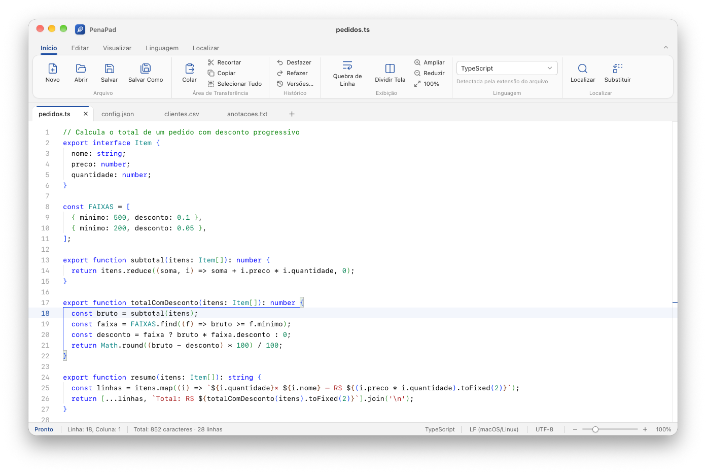
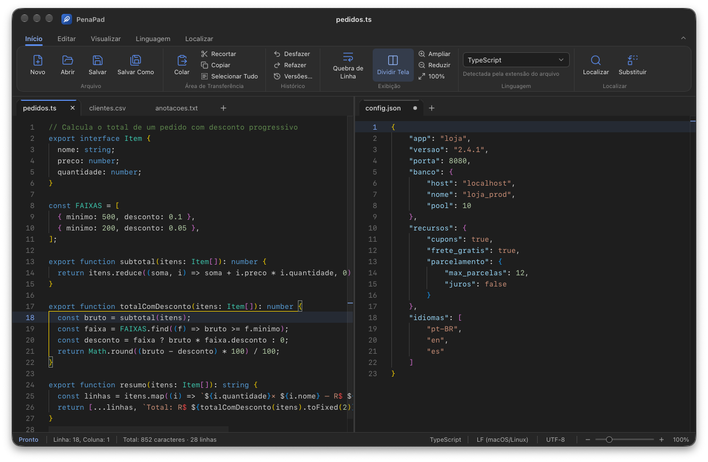
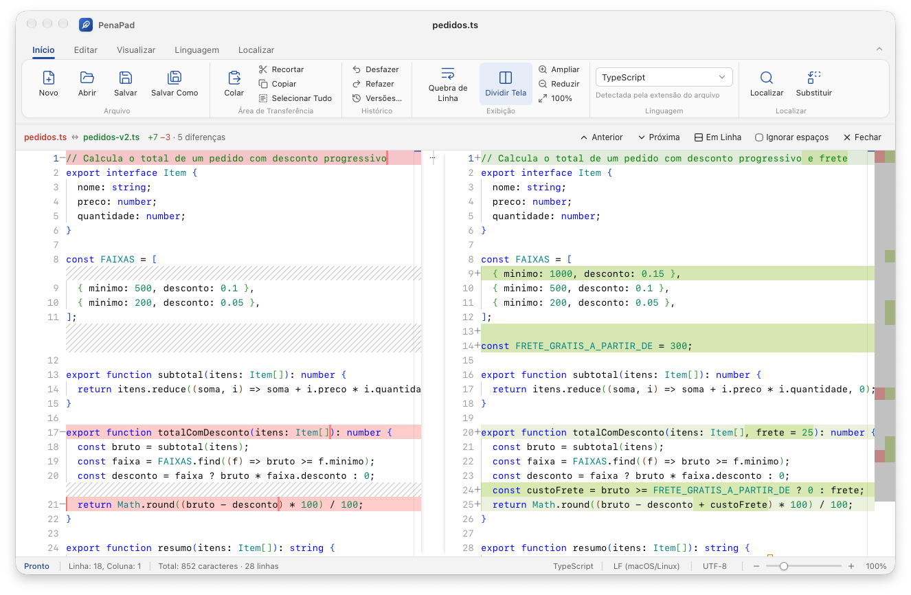
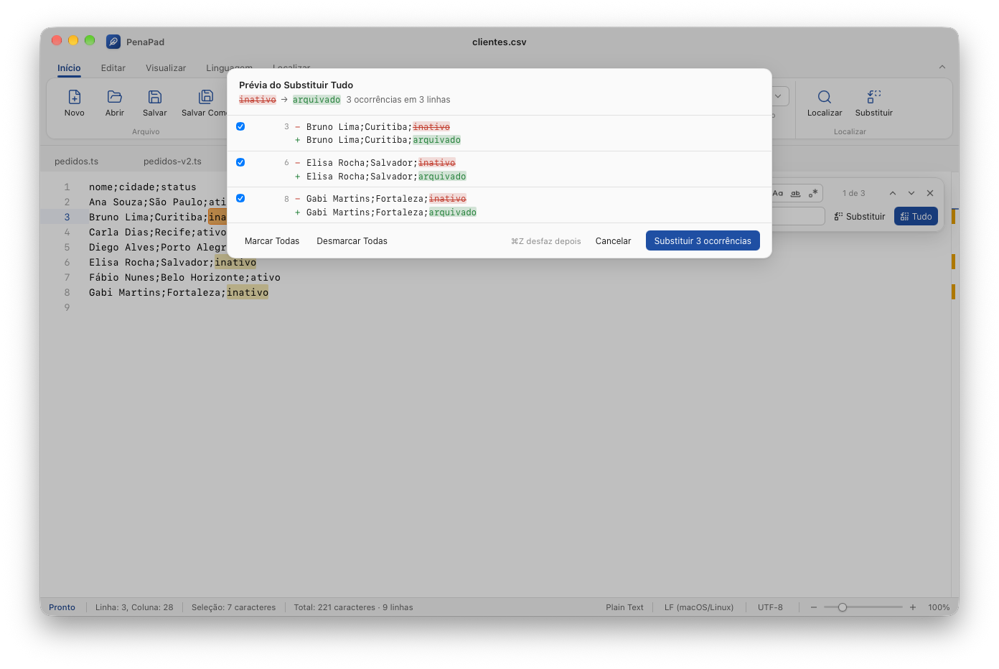
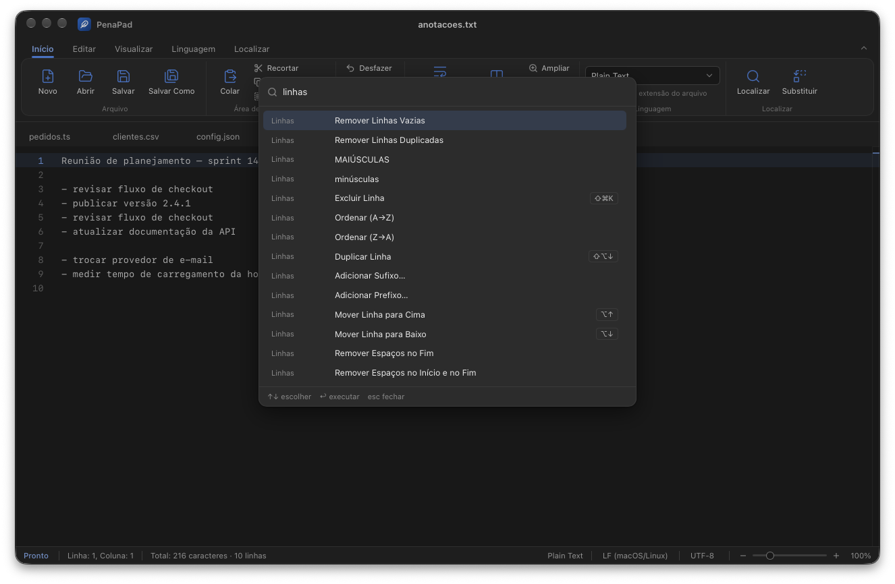
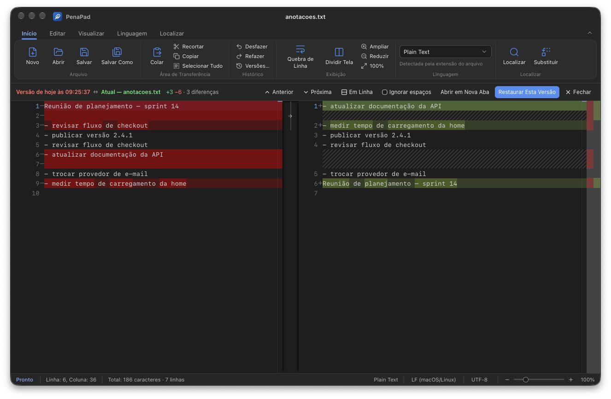

<p align="center">
  
</p>

<h1 align="center">PenaPad</h1>

<p align="center">
  Editor de texto e código leve para macOS, no espírito do Notepad++.<br>
  Abas, tela dividida, comparação de textos, histórico de versões e nada se perde ao fechar.
</p>

<p align="center">
  <a href="https://github.com/RicardoPenaDev/PenaPad/releases/latest"><b>⬇ Baixar para macOS</b></a>
  · Apple Silicon e Intel · macOS 11 ou mais novo · gratuito e de código aberto
</p>



## Por que o PenaPad

- **Nada se perde ao fechar.** Feche o app com textos não salvos: na próxima vez eles voltam exatamente como estavam,
  com as abas, a posição do cursor e a tela dividida. Sem perguntas ao sair.
- **Histórico de versões local.** O PenaPad guarda versões do texto em disco (ao abrir, ao salvar, a cada 5 minutos
  e antes de qualquer troca grande). Dá para comparar com a versão atual e restaurar.
- **Leve.** Usa o WebView do próprio macOS (não leva um navegador inteiro junto) e carrega só as partes do
  editor que usa. Instalador de ~4 MB e cerca de 70–120 MB de memória no uso normal.
- **Do jeito do Mac.** Menus e clique direito nativos, tema claro e escuro, atalhos padrão do macOS, em português.

## Recursos

### Tela dividida
Dois arquivos lado a lado (ou um em cima do outro), cada lado com suas próprias abas. `⌘\` divide e junta;
clique direito numa aba para mandá-la para o outro lado.



### Comparar textos
Compare duas abas, uma aba com o texto copiado, com a versão do disco ou com uma versão do histórico.
Diferenças destacadas por linha e por palavra, navegação com `F7` / `⇧F7`, lado a lado ou em uma coluna.



### Substituir Tudo com prévia
Antes de trocar, o PenaPad mostra cada linha que vai mudar (antes e depois). Dá para desmarcar linhas.
Funciona com expressões regulares e grupos (`$1`, `$2`). Um `⌘Z` desfaz tudo.



### Paleta de comandos
`⇧⌘P` e digite parte do nome de qualquer função — sem precisar lembrar onde fica no menu.
Também troca a linguagem e pula para qualquer aba aberta.



### Histórico de versões
`⇧⌘H` lista as versões guardadas do documento. Abrindo uma, ela aparece comparada com o texto atual,
com opções para restaurar ou abrir numa aba nova.



### E mais
- **Linhas:** ordenar (A→Z, Z→A, com números na ordem certa), remover duplicadas, remover vazias, limpar espaços,
  adicionar prefixo/sufixo, duplicar, mover e excluir linhas. Valem para a seleção ou para o documento todo.
- **Vários cursores e seleção em coluna:** `⌘D`, `⇧⌘L`, `⌘` + clique, `⌥` + arrastar.
- **JSON:** formatar e validar; erros aparecem na barra de status com linha e coluna, e um clique leva até eles.
- **Arquivos alterados por outros programas:** o PenaPad percebe e oferece comparar, recarregar ou manter sua versão.
  Também avisa se o arquivo foi apagado ou movido, sem perder o texto.
- **Reabrir aba fechada** (`⇧⌘T`), inclusive com texto não salvo.
- Realce de sintaxe para dezenas de linguagens, detecção pela extensão, quebra de linha, minimapa, zoom,
  codificações UTF-8 / UTF-16 / ASCII e quebras de linha LF / CRLF.

## Atalhos principais

| Ação | Atalho |
|---|---|
| Paleta de comandos | `⇧⌘P` |
| Dividir tela | `⌘\` |
| Localizar / Substituir | `⌘F` / `⌥⌘F` |
| Substituir Tudo (com prévia) | `⌘↩` no campo Substituir |
| Reabrir aba fechada | `⇧⌘T` |
| Histórico de versões | `⇧⌘H` |
| Selecionar próxima ocorrência / todas | `⌘D` / `⇧⌘L` |
| Duplicar / mover / excluir linha | `⇧⌥↓` / `⌥↑` `⌥↓` / `⇧⌘K` |
| Formatar documento | `⇧⌥F` |
| Ir para linha | `⌃G` |
| Quebra automática de linha | `⌥Z` |

Todos os atalhos aparecem nos menus e na paleta de comandos.

## Instalação

1. Baixe o `PenaPad_x.y.z_universal.dmg` na [página de versões](https://github.com/RicardoPenaDev/PenaPad/releases/latest).
2. Abra o arquivo e arraste o PenaPad para **Aplicativos**.
3. **Primeira abertura:** o app ainda não é assinado com um certificado da Apple, então o macOS mostra um aviso.
   Abra o PenaPad uma vez, feche o aviso e vá em **Ajustes do Sistema → Privacidade e Segurança**, role até o fim
   e clique em **Abrir Mesmo Assim**. Isso só é necessário uma vez.

   Se preferir pelo Terminal:
   ```sh
   xattr -dr com.apple.quarantine /Applications/PenaPad.app
   ```

### Onde ficam os dados
Tudo fica só no seu Mac, em `~/Library/Application Support/com.ricardopena.penapad/`:
`session.json` e `backup/` (textos abertos) e `history/` (versões: até 50 por documento, 30 dias, 200 MB no total).
O PenaPad não se conecta à internet.

## Compilar a partir do código

Requisitos: macOS, [Node.js](https://nodejs.org) 20+, [Rust](https://rustup.rs) e as ferramentas de linha de comando do Xcode.

```sh
git clone https://github.com/RicardoPenaDev/PenaPad.git
cd PenaPad
npm install
npm start          # abre em modo de desenvolvimento
npm run dist       # gera o instalador (.dmg) para Apple Silicon
npx tauri build --target universal-apple-darwin --bundles dmg   # Apple Silicon + Intel
```

Feito com [Tauri 2](https://tauri.app), [React](https://react.dev), [Monaco Editor](https://microsoft.github.io/monaco-editor/)
e [Tailwind CSS](https://tailwindcss.com). Estrutura:

```
src/                interface (React + TypeScript)
  App.tsx           abas, tela dividida, sessão, comandos
  components/       barra de opções, busca, comparação, paleta, diálogos
src-tauri/src/      parte nativa (Rust)
  lib.rs            arquivos, sessão, menus nativos
  history.rs        histórico de versões em disco
```

## Licença

[MIT](LICENSE) © 2026 Ricardo Pena. Componentes de terceiros em [THIRD_PARTY_NOTICES.md](THIRD_PARTY_NOTICES.md).

O PenaPad é um projeto independente, sem relação com o Notepad++ ou com a Microsoft.

---

### English

**PenaPad** is a lightweight, free and open-source text and code editor for macOS, inspired by Notepad++.
Unsaved text survives quitting, and it has tabs, split view, text compare, local version history, Replace All
with preview, a command palette (`⇧⌘P`), line tools, multi-cursor and JSON formatting.
Built with Tauri 2 + Monaco. The interface is in Brazilian Portuguese.
[Download the latest release](https://github.com/RicardoPenaDev/PenaPad/releases/latest) (Apple Silicon and Intel, macOS 11+).
MIT licensed.
