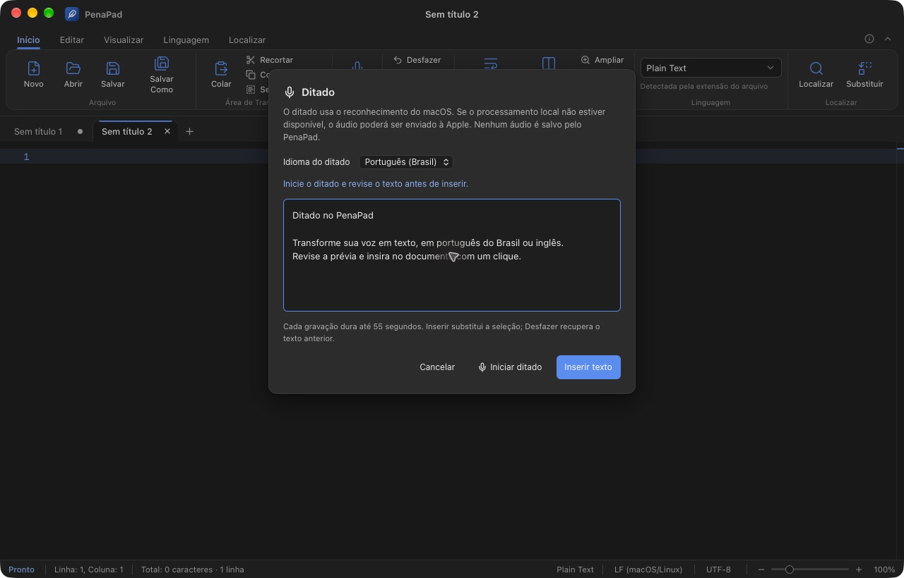

# PenaPad 1.3.0 — Ditado em português e inglês no Mac

Agora é possível transformar fala em texto pelo botão **Início → Ditado** ou pela paleta de comandos.

- Escolha **Português (Brasil)** ou **English (US)**, independentemente do idioma da interface.
- Veja a transcrição na prévia, pare para revisar e clique em **Inserir texto**.
- A inserção respeita o cursor/seleção original e pode ser desfeita em uma única ação.
- Se o documento mudar durante o ditado, o PenaPad preserva a prévia e evita sobrescrever suas alterações.
- **Cancelar** ou **Esc** interrompe a captura sem inserir. Cada sessão dura até 55 segundos.

## Primeiro uso no macOS

Ative **Ajustes do Sistema → Teclado → Ditado** e permita que o PenaPad acesse o microfone e o reconhecimento
de fala quando o macOS solicitar. Se o Ditado estiver desativado, o aplicativo mostra onde habilitá-lo.

O recurso usa o reconhecimento de fala do macOS. O processamento é local quando suportado; caso contrário,
o áudio pode ser enviado à Apple. O PenaPad não salva gravações de áudio.

## Compatibilidade e validação

O ditado integrado desta versão está disponível **somente no macOS**. Os instaladores do Windows e Linux
continuam disponíveis, com os demais recursos do editor.

Transcrição real em PT-BR confirmada no Mac. A seleção de inglês e os fluxos da interface foram testados
automaticamente; transcrição real em inglês ainda não foi validada.

Validação local: 48 testes Vitest, 24 testes Playwright e 18 testes Rust, além do teste real de voz em PT-BR.
